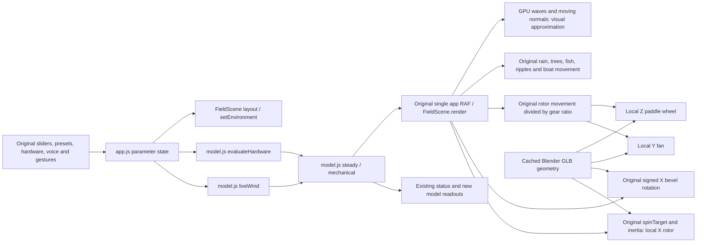

# ZeroWatt Wind graphics implementation and verification

The authoritative deliverable is the modified project at
`G:\new_8\zerowatt-wind-v8`. Nothing was pushed, published or deployed.

The subsequent Application 1 building/VFX work is documented in
`VENTILATION-IMPLEMENTATION.md`, including its controls, additional assets,
verification and remaining browser limitation.

## Original audit and baseline

- Existing application: plain JavaScript, vendored Three.js r180, esbuild 0.25,
  CommonJS Node development server on port 5500. Dependencies were installed.
- `index.html` loads `model.js`, the esbuild IIFE `app.bundle.js`, then the
  offline voice, breath and Jarvis input systems. `app.js` owns parameters,
  weather presets, hardware selection, mode switching and the single RAF loop.
- `scene.js` owns cameras, controls, layout, machinery, particles, weather and
  boat movement. `model.js` owns the engineering calculations. It is unchanged.
  The original camera uses a 38-degree vertical field of view with 0.1/240 clip
  planes. Drag orbit, wheel/pinch zoom, keyboard orbit and reset remain custom
  controls; no replacement OrbitControls dependency was introduced.
- Air units: up to ten through the original UI, two roof rows when needed.
  Pond: up to six boats, two units per boat; moving and moored mounts retained.
- Air weather: rooftop breeze, canyon, heatwave, monsoon and cyclone. Pond:
  park breeze, sheltered lull, hot night, monsoon and storm surge. Night is an
  existing pond case; no new simulation conditions were added.
- Existing voice, face, hand, breath, fullscreen, door, window, brake, camera,
  hardware and accessibility features remain in place. No chart UI existed in
  this checkout; model sweep functions are retained, and no invented chart was
  added. Metrics added to the interface read the existing steady-state model.
- The initial build succeeded. Initial tests: 30 passed, one failed. The
  pre-existing failure is `tests/jarvis.test.cjs:123`, where the test expects
  `wind speed 12` to leave wind at 2.5 but the parser sets it to 12. Jarvis source
  and that test were not modified.
- Pre-existing edits/untracked work were present in `scene.js`, `app.bundle.js`,
  `premium-assets.js`, `tools/build_rotor.py` and `assets/premium/`. Their source
  baseline is preserved in `.upgrade-baseline/before-upgrade.zip` and the
  tracked patch in `.upgrade-baseline/preexisting.patch`. The old rotor assets
  and generator remain on disk; the new pipeline uses `assets/zw-upgrade/`.
- Original `zerowatt-wind-v8.zip` was found in the parent directory; the two
  existing fixed/offline-voice ZIPs in this checkout were left untouched.
- Browser navigation to localhost was denied by the browser permission gate.
  No before/after browser screenshots or browser performance claims are made.
  The referenced live GitHub Pages URL was inaccessible to the web tool.

## Simulation-to-graphics dependency map



Engineering values include shaft power, available wind power, RPM, torque,
airflow, CO2, oxygen and coverage. Rotor display speeds retain the original
`spinTarget` curve, inertia and anti-aliasing caps; they are a visual mapping,
not a newly asserted measurement of physical RPM. Water waves, reflections,
grass, leaf detail, surfaces and architectural finishes are purely visual.

## Implemented graphics

- Blender spiral blades have real thickness, curved profiles, root braces,
  machined hubs and hex fasteners. Bevels have tapered 45-degree tooth forms.
- The fan has six twisted, cambered blades. The paddle has formed concave
  vanes, rolled rims, stiffeners, hub flanges and radial braces.
- Separate GLBs provide height-adjustable bearing frames and unscaled circular
  bearing cartridges. Shaft centerlines and all existing rotation signs and
  ratios are preserved. Only the content of animated pivot groups is replaced.
- GLBs load through the official matching r180 GLTFLoader. Cached templates,
  geometry and materials are shared; late loads cannot resurrect retired
  layouts. Original geometry is retained if a machine asset fails to load.
- Architecture retains the existing working enclosure, transparent cutaway
  roof with true exhaust openings, hinged windows and entrance door. It adds
  opaque rear/knee walls, floor joints, trim, low roof edging, Blender service
  cabinets and a Blender desk with monitor, keyboard and books. Existing
  simplified seated occupants remain to preserve occupancy visualization.
- Terrain has restrained variation. Trees use branches and individual opaque
  leaves; bank assets include reeds, cattails and stones. Perimeter grasses and
  distant windows are instanced. Background buildings are subdued and set back.
- Pond water uses an animated normal texture, Fresnel response from the PBR
  shader and prefiltered environment, shallow edge tint, and GPU displacement
  with analytic normals. Existing wheel-positioned ripples and power-dependent
  splashes remain intact. No fluid simulation or planar scene reflection is
  claimed. Geometry is no longer edited and renormalized on the CPU each frame.
- Lighting uses ACES/sRGB, existing shadowed sun and sky fill, a prefiltered
  reflection environment, a restrained night palette, and pond path lights.
  Supported weather continues to drive rain, exposure context and tree motion.
- Interface: refined teal/stone palette, typography, active states, focus
  outlines, larger touch controls, real model metrics and energy-transfer
  caption. The canvas comes first on narrow screens; every original control
  remains available. Pause/Play accessible names now follow the button state.
- Compact devices use a 1.25 pixel-ratio cap, 1024 shadows and fewer instanced
  grasses; desktop uses a 1.7 cap and 2048 shadows. No measured FPS is claimed.

## Assets and regeneration

Blender version actually executed: **5.2.2 LTS**. Thirteen runtime files exist:

`assets/zw-upgrade/rotor.glb`, `bevel.glb`, `fan.glb`, `paddle.glb`,
`bearing-frame.glb`, `bearing.glb`, `workspace.glb`, `service-wall.glb`,
`tree.glb`, `shore.glb` (all beneath the same directory).
The ventilation pass adds `chair.glb`, `controller.glb`, and `fan-shroud.glb`.

Editable source: `assets/zw-upgrade/zerowatt-library.blend`. Collections separate
the assets; static meshes within each asset are merged by material. The library
is organized as an asset library, not as a single assembled scene.

All coordinates in the Python helpers are expressed in Three.js Y-up space.
`V(x,y,z)=(x,-z,y)` converts once to Blender Z-up; glTF export converts back.
Rotor and bevel origin: local X axis at zero. Fan: local Y. Paddle: local Z.
Bearing cartridges use local X and are positioned at the existing stand height.
No keyframed or baked motion is used.

`manifest.json` records exact exported bytes, mesh and triangle counts.
`asset-validation.json` independently records dimensions from the actual loader.
`blend-validation.json` records reopening the saved source.

PowerShell commands from the project root:

```powershell
npm ci
npm run assets:build
npm run build
npm start
# In another terminal, after stopping the development server if it owns 5500:
npm run preview
npm test
npm run verify:graphics
npm run assets:review
node tools/run-blender.cjs scripts/blender/validate_library.py
node tools/deliver-sources.cjs
```

Direct Blender generation/export (no separate optimization tool is used):

```powershell
& 'C:\Program Files\Blender Foundation\Blender 5.2\blender.exe' --background --python scripts/blender/build_assets.py
```

`tools/run-blender.cjs` also accepts a `BLENDER_PATH` environment override.
Optimization is built into generation: evaluated bevels, merging by material,
shared templates, no external textures, no unnecessary hidden interior meshes.
The build emits `app.bundle.js` in place; there is no Vite or dist directory.
`npm start` and `npm run preview` both serve that built bundle at
`http://localhost:5500`. Asset URLs are document-relative, preserving the
GitHub Pages `/zero_watt_wind/` base path. No hosting configuration was changed.

## Verification and limits

- Production build passes (`build-results.log`).
- Complete automated suite: **39 passed / 1 pre-existing voice test failed**
  (`test-results.log`). All nine added graphics/UI/VFX tests pass.
- Engineering source SHA-256 and **84/84 baseline outputs** match exactly,
  including both modes, wind boundaries, counts, and the manual brake.
- Every GLB parses through the real runtime loader. Positions are finite,
  dimensions/axes match expectations, and mesh/triangle counts match Blender.
- Offline integration: **16/16 combinations pass**, covering both modes,
  supported clear/heat/rain/storm/night variants, one/maximum installations,
  moving/moored pond mounts, original animation ratio/direction, pause,
  close-up visibility and camera containment of the complete rotor.
- DOM tests exercise every slider range/step, hardware and profile selection,
  all ten presets, mode tabs, steppers, brake, reset, suggest, door, zoom,
  flow, pause, close-up, keyboard tab switching and reduced-motion startup.
- `scene-verification.json` includes actual visible geometry counts measured
  from the offline scene graph, **not GPU draw-call or FPS measurements**.
- Blender reviews render actual FieldScene mesh snapshots, and are labeled
  `*-blender-review.png`. They are not browser screenshots. Their lighting,
  transparency and water differ from Three.js; UI and particles are absent.
- Browser screenshots, WebGL shader compilation, browser console errors,
  actual fullscreen, orbit/touch behavior, responsive layout and hardware FPS
  remain **unverified** because a saved browser permission/managed policy denied
  navigation even after the user approved a new inspection. DOM/offline tests
  do not replace those checks. Final visual acceptance needs an authorized
  browser session, especially for water and phone viewport composition.
- Blender exported all models successfully. Its OS thumbnail-cache write to
  `C:\Users\rafiu\.thumbnails` produced a nonfatal OpenImageIO warning under
  the sandbox. The actual BLEND and GLBs were saved and independently loaded.
  No external thumbnails are required at runtime.
- Materials use compatible glTF PBR. Original fallback geometry, occupants,
  basin and substantial architecture remain procedural by design; the source
  was enhanced rather than replaced. No external texture artwork was needed.

## Complete sources and file inventory

`SOURCE-DELIVERY.md` contains full final copyable text for each modified/new
source file, with exact repository paths. It omits minified bundles and binary
files. `FILES.json` records source/binary/generated classifications, sizes and
SHA-256 hashes. The runtime bundle is generated from `app.js` by esbuild.

Existing `assets/premium/`, `tools/build_rotor.py`, archives, user screenshots,
`style.css`, `jarvis.js`, `jarvis.css`, vendor input models and calculation
source were preserved. Source files on disk are authoritative.
